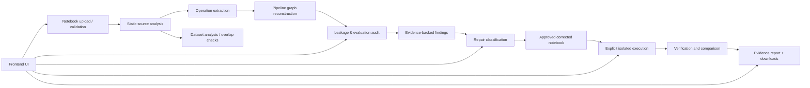
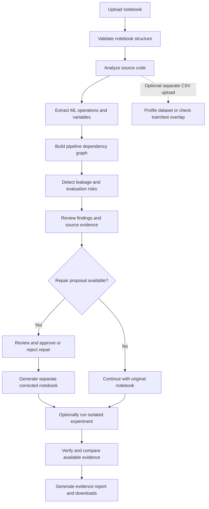

# CodeTrace

CodeTrace is an evidence-grounded notebook auditing system for machine-learning workflows. It validates uploaded Jupyter notebooks, extracts structural and source-level signals, reconstructs the ML pipeline from static code patterns, flags supported leakage and evaluation risks, and supports reviewable repair proposals and evidence reporting.

This project is intentionally conservative: it does not execute untrusted notebook code during parsing or analysis, and it treats findings as source-linked evidence rather than absolute proof of runtime defects.

## Why this matters

Data leakage and flawed evaluation are among the most common reasons that ML notebook results look better than they really are. The pattern may be spread across multiple cells, several variable names, and different preprocessing or model-training steps. In practice, reviewers often need help identifying where the issue starts, which operations are connected, and which findings are supported by source evidence versus still uncertain.

CodeTrace helps by giving a structured review workflow around these questions:

- What operations are present in the notebook?
- How are they connected by variable flow?
- Which cells or operations are implicated by a potential issue?
- Is the issue strongly supported or still only a risk signal?
- Can a deterministic repair be proposed without overwriting the original notebook?
- What evidence remains after an approved corrected version is generated and compared?

## Who benefits

CodeTrace is designed for several audiences:

- Data scientists and ML engineers reviewing notebook workflows before reporting results.
- Research teams validating whether preprocessing, splitting, and feature selection are appropriately separated.
- ML reviewers who need source-level evidence without executing untrusted code.
- Students and educators learning to reason about leakage and evaluation design.
- Audit and compliance teams that want a traceable, explainable notebook evidence trail.

## What makes CodeTrace different and novel

CodeTrace is not just a notebook linter or a notebook viewer. Its novelty is the combination of:

- static source-grounded notebook analysis rather than blind execution
- source-linked pipeline reconstruction across ML operations
- graph-based dependency tracing from recognized variable relations
- audit findings that include severity, confidence, evidence, and limitations
- repair proposals that are narrowed to safe, supported patterns only
- separate corrected-notebook generation that preserves the original upload
- isolated execution and verification as explicit follow-on steps rather than implicit trust

This approach is different from generic ML notebook tooling because it emphasizes evidence, traceability, and reviewability rather than generating a broad but untrustworthy warning list.

## Comparison with existing approaches

Common existing approaches in this space often focus on one of the following:

- notebook visualization only
- static linting with generic code-quality checks
- package-specific model checks without explaining notebook workflow context
- runtime execution that executes untrusted code automatically
- report generation without a rigorous source evidence trail

CodeTrace differs by combining these elements in a bounded, review-first workflow:

- It parses notebooks safely and stays static during review.
- It reconstructs an ML pipeline as a graph of operations and dependencies.
- It associates suspected issues with actual source references and variables.
- It avoids claiming a runtime defect when only static source evidence is available.
- It keeps repair generation limited to patterns that can be validated conservatively.
- It separates original, corrected, and execution artifacts so the evidence remains inspectable.

## Architecture overview

The frontend remains lightweight and static, while the FastAPI backend handles notebook validation, source analysis, graph assembly, detection, repair generation, execution requests, verification, and report artifacts.

## End-to-end workflow

## Current implementation

The repository currently includes:

- notebook upload and validation for Jupyter Notebook v4 files
- source-only static analysis of imports, dataset references, and ML operations
- pipeline graph generation from recognized operations and variable dependencies
- supported leakage and evaluation audit rules for notebook source patterns
- CSV analysis and train/test overlap checks
- narrow deterministic repair proposals where the pattern is safe and supported
- corrected notebook generation that preserves the original upload
- isolated execution support and verification/comparison logic
- evidence report generation in HTML, PDF, and JSON formats

## Project architecture

### Frontend
The frontend is a static HTML, CSS, and JavaScript application. It keeps the existing light CodeTrace theme and exposes notebook upload, overview, pipeline trace, audit review, repair center, experiments, verification, and report views.

### Backend
The backend is a FastAPI application in `backend/app/main.py` and it exposes notebook, dataset, repair, execution, verification, and report endpoints.

### Core services 
### ``backend/app/services/``
- `notebook_parser.py` — validates notebook structure and extracts cell metadata
- `notebook_analyzer.py` — extracts imports, dataset references, operations, and findings
- `pipeline_trace.py` — builds the static dependency graph
- `detection_engine.py` — supports source-based evaluation and leakage checks
- `repair_engine.py` — generates narrow deterministic repair proposals
- `dataset_analyzer.py` — profiles CSV inputs without exposing row values
- `dataset_overlap.py` — compares explicitly uploaded train/test datasets
- `execution_manager.py` and `backend/app/services/docker_runner.py` — isolate notebook execution
- `verification_engine.py` — compares original and corrected execution artifacts
- `report_service.py` — builds evidence snapshots and exports

## Key workflow principles

- Static analysis first; no notebook execution during upload or parser review.
- Source-linked evidence instead of silent assumptions.
- Separate original and corrected artifacts.
- Reviewable repair proposals rather than automatic rewrite of notebook code.
- Explicit verification after execution, not inference from a passing run alone.

## Safety and limitations

The project is intentionally conservative. It does not claim to be a complete runtime leakage detector, and it does not treat a green graph or a passing repair as proof of safety.

Current limitations include:

- source-only inference, not full runtime tracing
- deterministic repair proposals only for narrowly supported patterns
- ambiguous or context-dependent findings require manual review
- execution verification is only as strong as the captured evidence and comparable conditions

## Summary

CodeTrace is designed as an evidence-first review environment for ML notebooks. Its value is not in pretending to know everything about a notebook from a single static pass, but in providing a transparent, source-linked, reviewable workflow that gives teams structured evidence and safe, bounded actions to take next.

